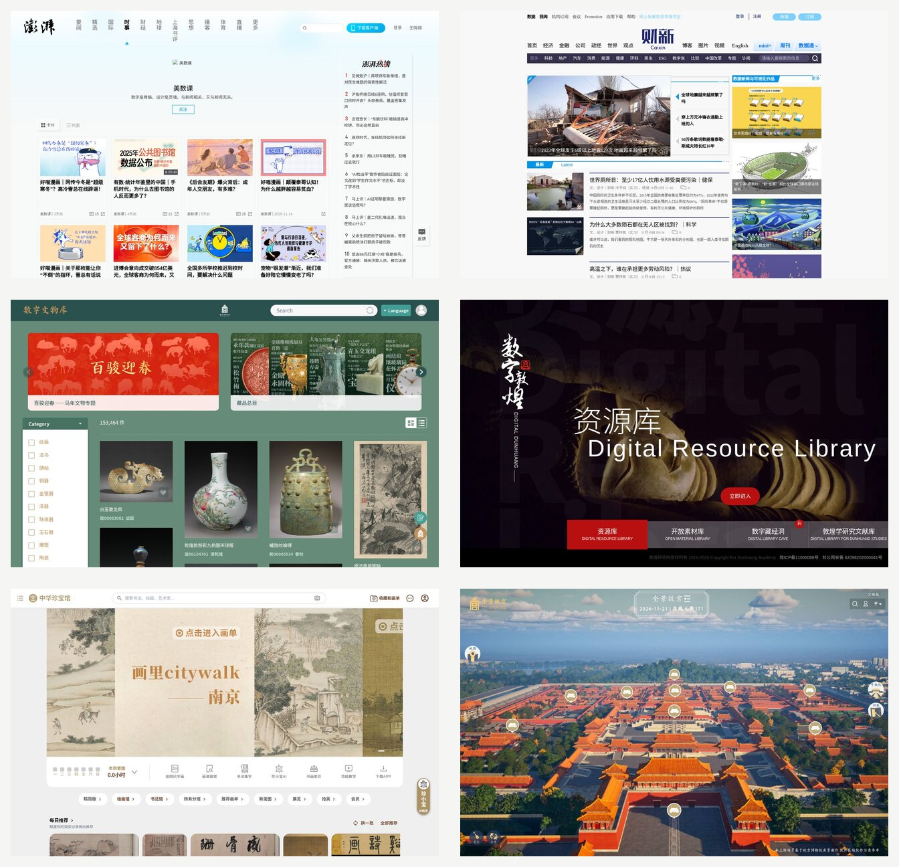
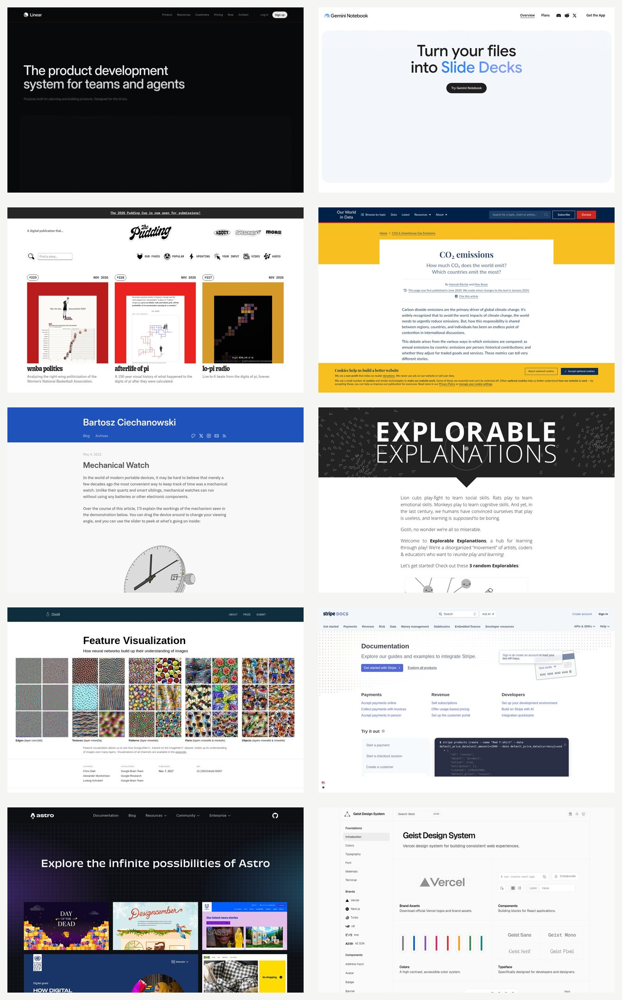

# 前端与交互设计参考库（Frontend & Interaction Reference Library）

本仓库是面向**新闻传播教学、学生竞赛指导（计算机设计大赛 / NCDA 等）与 AI 研判/知识库系统研发**的公开前端与交互设计参考库。参照 `ppt-reference-library` 的“候选→人工认可→沉淀偏好”机制维护，只收录**真实上线、可打开体验**的线上网页案例，不收无线上地址的概念飞机稿。

现有 **16** 组候选案例（覆盖全部 4 条工作主线，含 6 组中文数据新闻与数字人文标杆），已认可 **0** 组，等待宏哥审看与标定偏好。

## 四条聚焦主线

1. **AI 工作台与人机协同**（`F01`–`F02`）：服务舆情研判工作台、问答知识库与科研分析工具，重点看分栏协作、证据溯源、任务状态可观测与高密度信息降噪。
2. **数据新闻与滚动叙事**（`F03`–`F04`、`F11`–`F12`）：服务融合新闻、互动媒体与数据新闻教学，重点看 Scrollytelling 滚动联动、中文数据新闻专题排印与可引用数据口径。
3. **可交互解释与数字人文**（`F05`–`F07`、`F13`–`F16`）：服务竞赛指导与丝路/传统文化及 AI 叙事教学，重点看 Explorable Explanations、多维藏品检索、丝路数字资源门户与全屏空间全景 HUD。
4. **教学门户与轻量化落地页**（`F08`–`F10`）：服务课程讲义站、项目演示入口与组件体系，重点看双栏对照文档、站内检索与克制的设计系统规范。

## 批次总览拼图

### 第二批：中文数据新闻与数字人文（`F11`–`F16`）

### 第一批：四条主线国际标杆（`F01`–`F10`）

## 案例目录

| 编号 | 案例拆解 | 主线 | 原始线上页面 | 核心可借鉴机制 | 状态 |
| --- | --- | --- | --- | --- | --- |
| F01 | [高密度研发与智能体工作台](references/F01-linear/README.md) | AI 工作台与人机协同 | [Linear](https://linear.app/) | 暗色低干扰信息层级、键盘优先与命令面板 | 候选 |
| F02 | [多源资料库与证据溯源工作区](references/F02-notebooklm/README.md) | AI 工作台与人机协同 | [Gemini Notebook（原 NotebookLM）](https://notebooklm.google/) | 资料源列表 + 对话问答 + 输出画布三栏布局、行内引用角标与原文溯源高亮 | 候选 |
| F03 | [视觉叙事论文目录与滚动叙事标杆](references/F03-the-pudding/README.md) | 数据新闻与滚动叙事 | [The Pudding](https://pudding.cool/) | 编辑式视觉索引卡片、按媒介维度筛选（Video/Audio/Your Input） | 候选 |
| F04 | [可引用数据新闻与 Grapher 交互看板](references/F04-our-world-in-data/README.md) | 数据新闻与滚动叙事 | [Our World in Data — CO2 Emissions](https://ourworldindata.org/co2-emissions) | 长文叙事与嵌入式交互图表融合、Chart/Map/Table 同源视图切换 | 候选 |
| F05 | [机械原理可交互三维拆解长文](references/F05-ciechanowski-mechanical-watch/README.md) | 可交互解释与数字人文 | [Mechanical Watch](https://ciechanow.ski/mechanical-watch/) | 正文段落穿插可拖拽 3D 模型、剖切滑块即时透视内部结构 | 候选 |
| F06 | [交互式科普与教学作品聚合枢纽](references/F06-explorable-explanations/README.md) | 可交互解释与数字人文 | [Explorable Explanations](https://explorabl.es/) | 低门槛趣味导语、按学科主题浏览交互式解释作品 | 候选 |
| F07 | [交互式人工智能学术论文排版范式](references/F07-distill-feature-viz/README.md) | 可交互解释与数字人文 | [Distill — Feature Visualization](https://distill.pub/2017/feature-visualization/) | 宽幅视觉矩阵首屏导读、边注（Sidenotes）与行内悬停引文 | 候选 |
| F08 | [双栏对照与交互式代码文档金标准](references/F08-stripe-docs/README.md) | 教学门户与轻量化落地页 | [Stripe Docs](https://docs.stripe.com/) | 全局快捷键搜索 + Ask AI 入口并置、清晰的分层任务导航（Payments/Revenue/Developers） | 候选 |
| F09 | [内容驱动型现代站点精选门户](references/F09-astro-showcase/README.md) | 教学门户与轻量化落地页 | [Astro Showcase](https://astro.build/showcase/) | 暗色渐变首屏 + 响应式作品卡片网格、零冗余信息架构的顶部导航 | 候选 |
| F10 | [极简黑白灰设计系统与组件规范](references/F10-vercel-geist/README.md) | 教学门户与轻量化落地页 | [Vercel Geist Design System](https://vercel.com/geist/introduction) | 左侧分组组件树 + 右侧实时组件画廊、克制的黑白灰语义色阶与高对比度可访问性色板 | 候选 |
| F11 | [中文数据新闻与可视化专栏门户](references/F11-thepaper-meishuke/README.md) | 数据新闻与滚动叙事 | [澎湃美数课](https://www.thepaper.cn/list_25635) | 高信息密度中文图文卡片网格、清晰话题封面字号与色彩编码 | 候选 |
| F12 | [严肃财经与公共议题数据视觉专题站](references/F12-caixin-datanews/README.md) | 数据新闻与滚动叙事 | [财新数据新闻](https://datanews.caixin.com/) | 首屏焦点专题 + 右侧可视化精选双栏架构、数据新闻与可视化作品独立推荐区 | 候选 |
| F13 | [超大规模文物多维检索与高清检视库](references/F13-dpm-digicol/README.md) | 可交互解释与数字人文 | [故宫博物院数字文物库](https://digicol.dpm.org.cn/) | 故宫青绿传统色系与现代检索界面的克制融合、左侧多维分类筛选树（器类/朝代）+ 右侧瀑布流文物卡 | 候选 |
| F14 | [丝路石窟数字资源与多库入口门户](references/F14-e-dunhuang/README.md) | 可交互解释与数字人文 | [数字敦煌](https://www.e-dunhuang.com/) | 深色沉浸式石窟视觉首屏 + 敦煌红功能入口底栏、四大子库清晰分流（资源库/开放素材库/数字藏经洞/研究文献库） | 候选 |
| F15 | [中国传统书画专题策展与高清交互平台](references/F15-ltfc-zhenbaoguan/README.md) | 可交互解释与数字人文 | [中华珍宝馆](https://www.ltfc.net/) | 浅宣纸色温底色 + 策展式主题横幅（如“画里 citywalk”）、顶部极简检索 + 下方多维学科/媒介图标导航 | 候选 |
| F16 | [空间热点与全景漫游数字展陈标杆](references/F16-dpm-pano/README.md) | 可交互解释与数字人文 | [全景故宫](https://pano.dpm.org.cn/) | 全屏鸟瞰全景画布 + 空间定位热点图钉、极简悬浮 HUD 控件（顶部标题与实时人数、左导览、右地图/中轴线切换） | 候选 |

## 仓库入口

- [维护与收录规则](AGENTS.md)
- [AI Agent 维护 Skill (`frontend-reference-curator`)](.agents/skills/frontend-reference-curator/SKILL.md)
- [案例发现常看清单](discovery-sources.md)
- [结构化总目录 (`catalog.json`)](catalog.json)
- [实测截屏校验清单 (`capture-manifest.json`)](capture-manifest.json)
- [已认可案例索引](approved/README.md)
- [审美与交互偏好记录](preferences.md)

## 公开仓库版权与语境说明

本仓库为公开资料库，所有案例均指向原作者公开发布的真实线上网址。仓库内不搬运第三方完整源码、字体或闭源商用素材包，仅保留少量等比例缩放的界面关键状态截屏用于教学与设计评述引用。AI 筛选点评仅作候选参考，不代表最终审美标准；案例中的示例数据与文本属于原作语境，不作为其他项目的事实证据。
