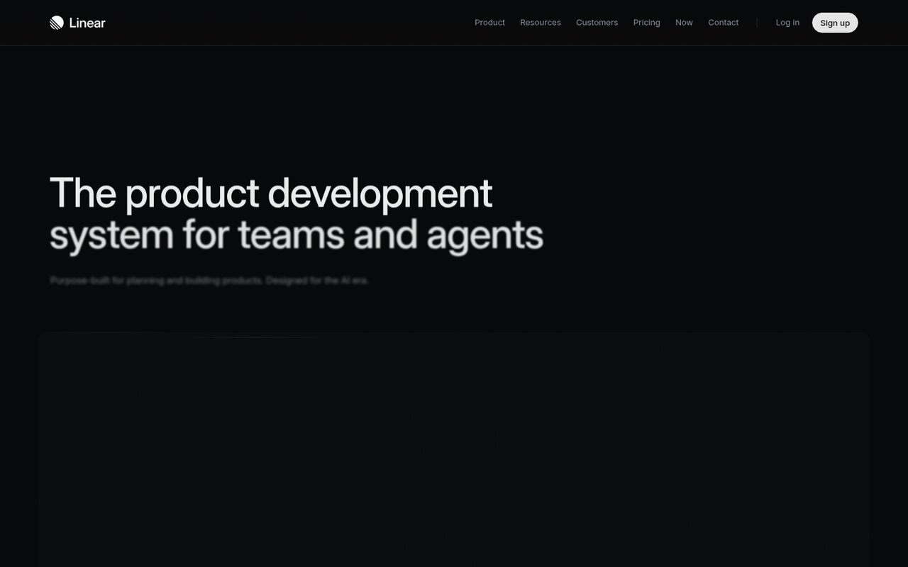

# F01 高密度研发与智能体工作台

原作：Linear。作者或机构：Linear。

状态：候选，尚未经宏哥认可。主线：AI 工作台与人机协同（`ai-workbench`）。类型：线上产品与交互展示页。

[访问真实线上页面](https://linear.app/)

## 实测界面截屏

## 核心交互与设计机制

- 暗色低干扰信息层级
- 键盘优先与命令面板
- 团队与 Agent 任务流整合
- 克制的微交互状态反馈

## 本轮筛选意见

以下为 AI 的交互与设计观察，等待宏哥判断。

- 可观察之处：在极高信息密度的任务与智能体协作场景下，仍能通过明度层级、细边框与精准留白保持界面克制；首屏已将 teams and agents 作为核心叙事。
- 与宏哥工作的关联：直接对应 yuqing-agent-system 研判工作台与控制台的信息降噪、左侧导航层级与长任务状态条设计。
- 局限与迁移边界：公开官网主要展示产品界面片段与叙事，完整工作台交互需登录体验；暗色主题迁移到政务/学术汇报场景时需注意对比度与投影可读性。
- 技术栈线索：React / Next.js 风格现代前端、CSS 变量设计令牌、硬件加速微动效

## 认可记录

等待宏哥指定整站、具体页面或局部交互机制。

## 来源与版权边界

核看与截屏日期：2026-11-21。截屏视口：1440×900（等比例缩放至 1280×800，未裁剪与改绘）。

第三方公开网页，原作者保留全部权利；本公开仓库仅保留原始链接与少量界面截屏用于教学、科研与设计评述引用，不搬运源码或商用素材包。
