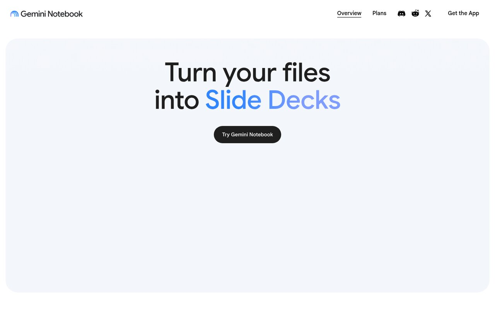

# F02 多源资料库与证据溯源工作区

原作：Gemini Notebook（原 NotebookLM）。作者或机构：Google。

状态：候选，尚未经宏哥认可。主线：AI 工作台与人机协同（`ai-workbench`）。类型：线上产品入口与交互范式。

[访问真实线上页面](https://notebooklm.google/)

## 实测界面截屏

## 核心交互与设计机制

- 资料源列表 + 对话问答 + 输出画布三栏布局
- 行内引用角标与原文溯源高亮
- 多模态资料转译（文档→简报/音频/演示稿）

## 本轮筛选意见

以下为 AI 的交互与设计观察，等待宏哥判断。

- 可观察之处：将封闭资料库、对话式问答与可追溯原文引用结合得最为清晰，避免通用聊天框的“无据可查”问题。
- 与宏哥工作的关联：直接对应 contest-hub 赛事知识库问答界面与 yuqing-agent-system 证据链核验（判断、证据、原文锚点联动）。
- 局限与迁移边界：官网首屏为产品入口页（2026-11 实测已更名为 Gemini Notebook），内部三栏工作区需 Google 账号登录查看。
- 技术栈线索：Google Material / 现代 Web 应用架构

## 认可记录

等待宏哥指定整站、具体页面或局部交互机制。

## 来源与版权边界

核看与截屏日期：2026-11-21。截屏视口：1440×900（等比例缩放至 1280×800，未裁剪与改绘）。

第三方公开网页，原作者保留全部权利；本公开仓库仅保留原始链接与少量界面截屏用于教学、科研与设计评述引用，不搬运源码或商用素材包。
