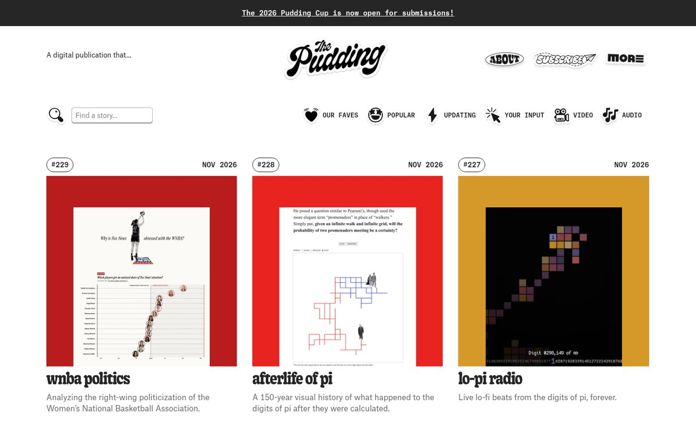

# F03 视觉叙事论文目录与滚动叙事标杆

原作：The Pudding。作者或机构：The Pudding。

状态：候选，尚未经宏哥认可。主线：数据新闻与滚动叙事（`data-journalism`）。类型：线上数据新闻与视觉叙事站。

[访问真实线上页面](https://pudding.cool/)

## 实测界面截屏

## 核心交互与设计机制

- 编辑式视觉索引卡片
- 按媒介维度筛选（Video/Audio/Your Input）
- Scrollytelling 滚动步进叙事
- 强叙事节奏的封面色彩编码

## 本轮筛选意见

以下为 AI 的交互与设计观察，等待宏哥判断。

- 可观察之处：国际视觉叙事与数据新闻的标杆站点；首页卡片本身就用极高辨识度的编辑式色块与摘要，示范了如何把数据故事包装成可浏览的作品集。
- 与宏哥工作的关联：直接服务《融合新闻产品策划与制作》《互动媒体设计》课程案例讲授，以及学生数据新闻专题作品的入口与滚动叙事结构。
- 局限与迁移边界：英文语境为主，部分单篇作品重度定制 SVG/Canvas；教学借鉴时应拆解其叙事脚本与滚动触发逻辑，而非照搬视觉装饰。
- 技术栈线索：Svelte / SvelteKit、D3.js、Scrollama、SVG/Canvas

## 认可记录

等待宏哥指定整站、具体页面或局部交互机制。

## 来源与版权边界

核看与截屏日期：2026-11-21。截屏视口：1440×900（等比例缩放至 1280×800，未裁剪与改绘）。

第三方公开网页，原作者保留全部权利；本公开仓库仅保留原始链接与少量界面截屏用于教学、科研与设计评述引用，不搬运源码或商用素材包。
