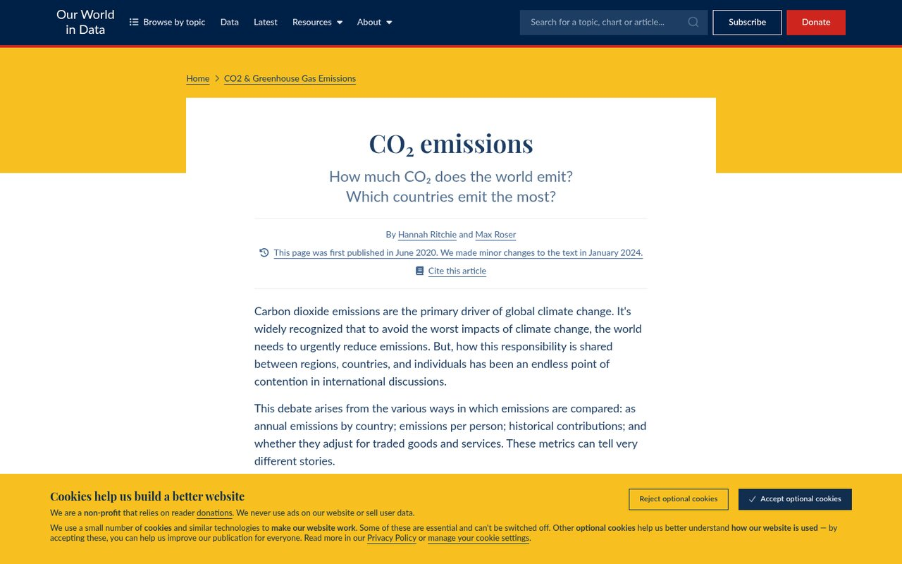

# F04 可引用数据新闻与 Grapher 交互看板

原作：Our World in Data — CO2 Emissions。作者或机构：Our World in Data (Global Change Data Lab)。

状态：候选，尚未经宏哥认可。主线：数据新闻与滚动叙事（`data-journalism`）。类型：线上开源数据叙事与交互图表站。

[访问真实线上页面](https://ourworldindata.org/co2-emissions)

## 实测界面截屏

## 核心交互与设计机制

- 长文叙事与嵌入式交互图表融合
- Chart/Map/Table 同源视图切换
- 时间轴滑块与国家多选对照
- 显性引用按钮与数据口径说明

## 本轮筛选意见

以下为 AI 的交互与设计观察，等待宏哥判断。

- 可观察之处：把严肃学术数据、新闻式导语和可探索图表无缝揉在一起，每张图都带口径说明、原始数据下载与标准引用入口。
- 与宏哥工作的关联：直接对应《统计与大数据分析》课程演示（如 HSL 共享单车看板）与民族风险/舆情研究报告的在线证据展示。
- 局限与迁移边界：首次访问底部会出现 Cookie 提示条；单页信息体量较大，迁移到课堂作业时可精简为“导语 + 单核心 Grapher 卡片”。
- 技术栈线索：TypeScript、React、开源 Grapher 图表引擎

## 认可记录

等待宏哥指定整站、具体页面或局部交互机制。

## 来源与版权边界

核看与截屏日期：2026-11-21。截屏视口：1440×900（等比例缩放至 1280×800，未裁剪与改绘）。

第三方公开网页，原作者保留全部权利；本公开仓库仅保留原始链接与少量界面截屏用于教学、科研与设计评述引用，不搬运源码或商用素材包。
