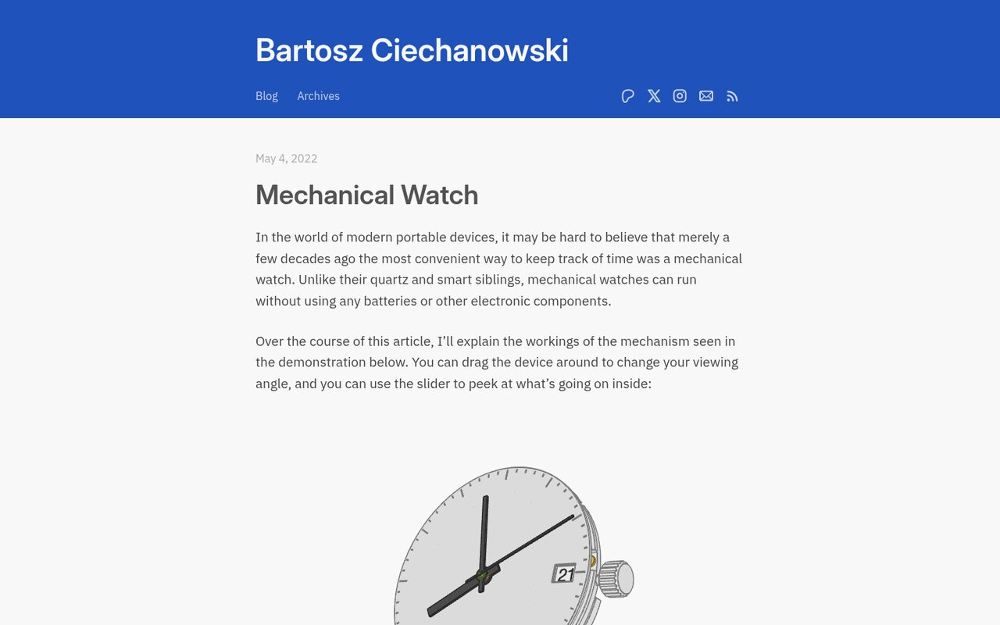

# F05 机械原理可交互三维拆解长文

原作：Mechanical Watch。作者或机构：Bartosz Ciechanowski。

状态：候选，尚未经宏哥认可。主线：可交互解释与数字人文（`explorable-humanities`）。类型：线上可交互解释长文（Explorable Explanation）。

[访问真实线上页面](https://ciechanow.ski/mechanical-watch/)

## 实测界面截屏

## 核心交互与设计机制

- 正文段落穿插可拖拽 3D 模型
- 剖切滑块即时透视内部结构
- 零冗余控件的阅读焦距
- 由浅入深的部件逐层装配叙事

## 本轮筛选意见

以下为 AI 的交互与设计观察，等待宏哥判断。

- 可观察之处：Explorable Explanations 的天花板级作品：把极其复杂的机械结构拆成几十个可动手拖拽、调速、剖切的小实验，完全靠交互把原理讲透。
- 与宏哥工作的关联：极度契合计算机设计大赛与 NCDA 的文化技艺/科学原理类作品指导（如榫卯结构《天地一榫》、古建筑与传统工艺拆解）。
- 局限与迁移边界：WebGL 与物理模拟工程量极高；教学与竞赛中建议学习其“文字解释 + 紧邻单变量交互滑块”的叙事单元结构，用 SVG 或轻量 Canvas 实现即可。
- 技术栈线索：原生 HTML/CSS、自定义 WebGL 渲染器、极简静态博客排版

## 认可记录

等待宏哥指定整站、具体页面或局部交互机制。

## 来源与版权边界

核看与截屏日期：2026-11-21。截屏视口：1440×900（等比例缩放至 1280×800，未裁剪与改绘）。

第三方公开网页，原作者保留全部权利；本公开仓库仅保留原始链接与少量界面截屏用于教学、科研与设计评述引用，不搬运源码或商用素材包。
