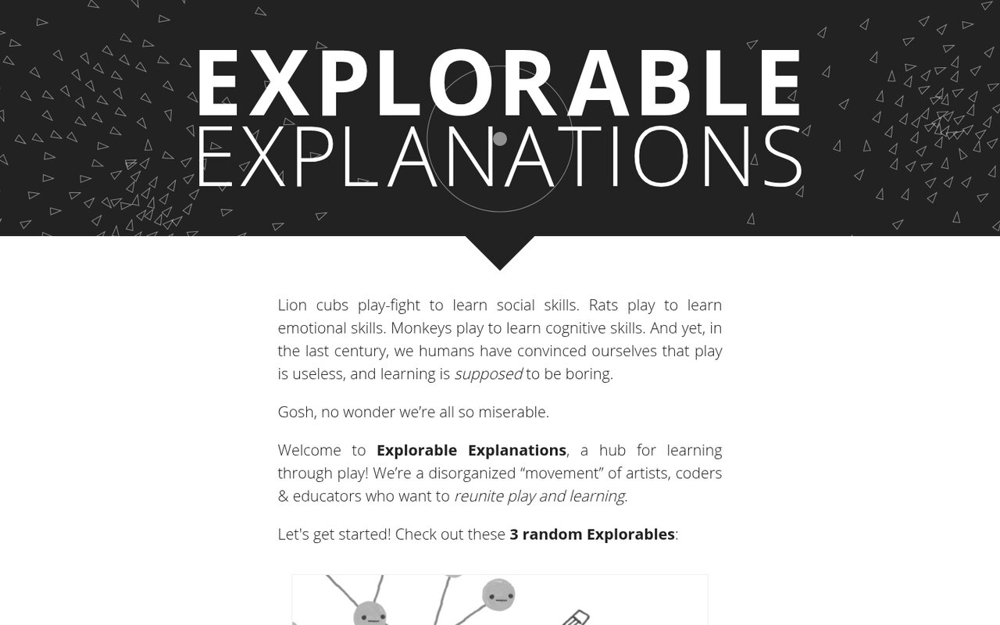

# F06 交互式科普与教学作品聚合枢纽

原作：Explorable Explanations。作者或机构：Explorable Explanations Community (initiated by Nicky Case)。

状态：候选，尚未经宏哥认可。主线：可交互解释与数字人文（`explorable-humanities`）。类型：线上社区聚合目录。

[访问真实线上页面](https://explorabl.es/)

## 实测界面截屏

## 核心交互与设计机制

- 低门槛趣味导语
- 按学科主题浏览交互式解释作品
- 单栏高可读内容流与随机探索入口

## 本轮筛选意见

以下为 AI 的交互与设计观察，等待宏哥判断。

- 可观察之处：系统汇总了数学、社会科学、新闻传播、物理、算法等领域的“可玩式解释”作品，本身就是一个极好的课堂选题库与灵感目录。
- 与宏哥工作的关联：直接用于《互动媒体设计》《大数据与人工智能》的课堂案例拓展，以及学生竞赛选题头脑风暴。
- 局限与迁移边界：聚合站本身界面复古轻巧，核心价值在于其收录的外部交互作品；部分早期外链作品可能已停服，课堂引用前需逐条核验。
- 技术栈线索：静态 HTML/CSS、轻量前端目录

## 认可记录

等待宏哥指定整站、具体页面或局部交互机制。

## 来源与版权边界

核看与截屏日期：2026-11-21。截屏视口：1440×900（等比例缩放至 1280×800，未裁剪与改绘）。

第三方公开网页，原作者保留全部权利；本公开仓库仅保留原始链接与少量界面截屏用于教学、科研与设计评述引用，不搬运源码或商用素材包。
