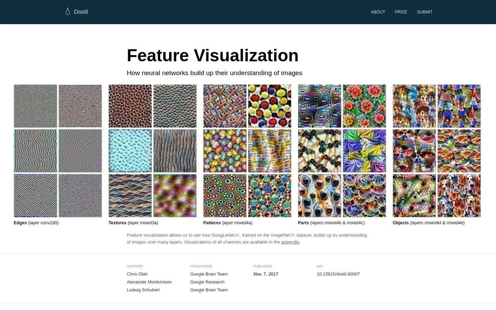

# F07 交互式人工智能学术论文排版范式

原作：Distill — Feature Visualization。作者或机构：Chris Olah, Alexander Mordvintsev, Ludwig Schubert (Distill)。

状态：候选，尚未经宏哥认可。主线：可交互解释与数字人文（`explorable-humanities`）。类型：线上交互式学术期刊论文。

[访问真实线上页面](https://distill.pub/2017/feature-visualization/)

## 实测界面截屏

## 核心交互与设计机制

- 宽幅视觉矩阵首屏导读
- 边注（Sidenotes）与行内悬停引文
- 正文与交互式图解并置
- 规范 DOI/作者/发表日期学术元信息栏

## 本轮筛选意见

以下为 AI 的交互与设计观察，等待宏哥判断。

- 可观察之处：将传统枯燥的 AI 学术论文转化为浏览器原生的互动阅读体验，视觉矩阵、边注和正文层次分明，兼顾学术严谨与直观理解。
- 与宏哥工作的关联：直接服务《大数据与人工智能》教学、研究生《丝路文化智能叙事与国际传播》课程展示，以及科研成果的 Web 化发布。
- 局限与迁移边界：Distill 期刊已进入休刊归档状态，但既有文章长期在线可访问；国内网络加载大图矩阵时需留意图片体积优化。
- 技术栈线索：Distill Template (Web Components / Svelte / D3.js)

## 认可记录

等待宏哥指定整站、具体页面或局部交互机制。

## 来源与版权边界

核看与截屏日期：2026-11-21。截屏视口：1440×900（等比例缩放至 1280×800，未裁剪与改绘）。

第三方公开网页，原作者保留全部权利；本公开仓库仅保留原始链接与少量界面截屏用于教学、科研与设计评述引用，不搬运源码或商用素材包。
