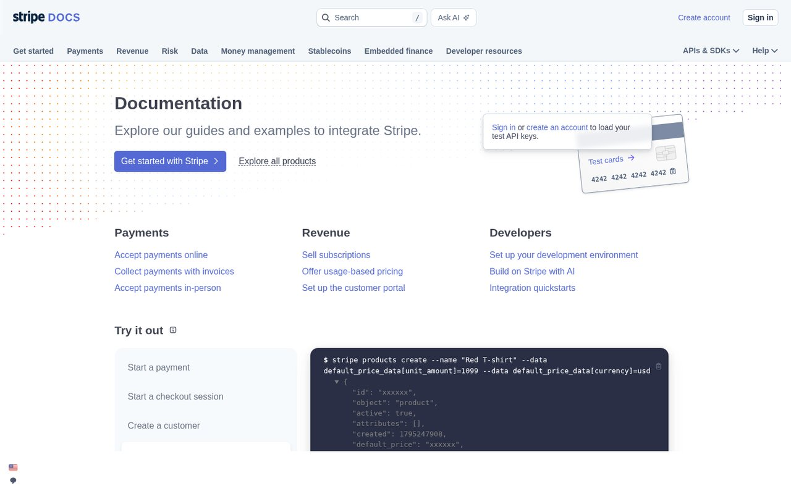

# F08 双栏对照与交互式代码文档金标准

原作：Stripe Docs。作者或机构：Stripe。

状态：候选，尚未经宏哥认可。主线：教学门户与轻量化落地页（`portal-docs`）。类型：线上开发者文档与交互示例门户。

[访问真实线上页面](https://docs.stripe.com/)

## 实测界面截屏

## 核心交互与设计机制

- 全局快捷键搜索 + Ask AI 入口并置
- 清晰的分层任务导航（Payments/Revenue/Developers）
- 页面内即时可切换代码的 Try it out 交互面板
- 极佳的浅色留白与边界线体系

## 本轮筛选意见

以下为 AI 的交互与设计观察，等待宏哥判断。

- 可观察之处：开发者文档与技术教学门户的行业标杆：首屏不堆砌术语，而是按任务路径分流，并直接在首屏提供可切换示例的交互代码块。
- 与宏哥工作的关联：直接对应 fe-webdev 课程讲义站、AI agent 教学文档以及自研系统的使用手册与 API 文档设计。
- 局限与迁移边界：商业产品文档体系庞大，教学站点只需借鉴其“顶部任务分类 + 左侧目录 + 嵌入式交互示例块”的核心骨架。
- 技术栈线索：Markdoc、React、现代设计系统

## 认可记录

等待宏哥指定整站、具体页面或局部交互机制。

## 来源与版权边界

核看与截屏日期：2026-11-21。截屏视口：1440×900（等比例缩放至 1280×800，未裁剪与改绘）。

第三方公开网页，原作者保留全部权利；本公开仓库仅保留原始链接与少量界面截屏用于教学、科研与设计评述引用，不搬运源码或商用素材包。
