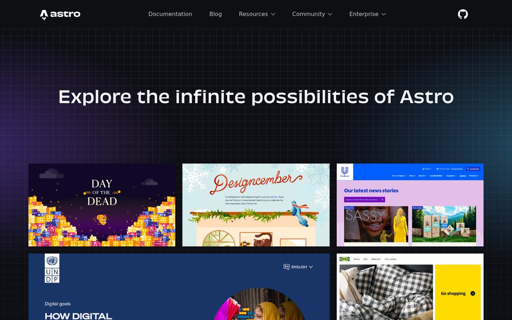

# F09 内容驱动型现代站点精选门户

原作：Astro Showcase。作者或机构：Astro。

状态：候选，尚未经宏哥认可。主线：教学门户与轻量化落地页（`portal-docs`）。类型：线上作品集与生态展示目录。

[访问真实线上页面](https://astro.build/showcase/)

## 实测界面截屏

## 核心交互与设计机制

- 暗色渐变首屏 + 响应式作品卡片网格
- 零冗余信息架构的顶部导航
- 真实上线站点直链与分类索引

## 本轮筛选意见

以下为 AI 的交互与设计观察，等待宏哥判断。

- 可观察之处：集中展示 Astro 生态下真实上线的内容站、文档站与个人主页，与宏哥现有的 Astro / Tailwind / Cloudflare Pages 技术栈完全同构。
- 与宏哥工作的关联：适合作为课程项目展示墙、学生竞赛作品集官网以及个人轻量落地页的直接布局参考。
- 局限与迁移边界：目录页本身偏展示型，具体交互模式需点入各入选站点逐个核看。
- 技术栈线索：Astro、Tailwind CSS、静态优先与局部水合（Islands）

## 认可记录

等待宏哥指定整站、具体页面或局部交互机制。

## 来源与版权边界

核看与截屏日期：2026-11-21。截屏视口：1440×900（等比例缩放至 1280×800，未裁剪与改绘）。

第三方公开网页，原作者保留全部权利；本公开仓库仅保留原始链接与少量界面截屏用于教学、科研与设计评述引用，不搬运源码或商用素材包。
