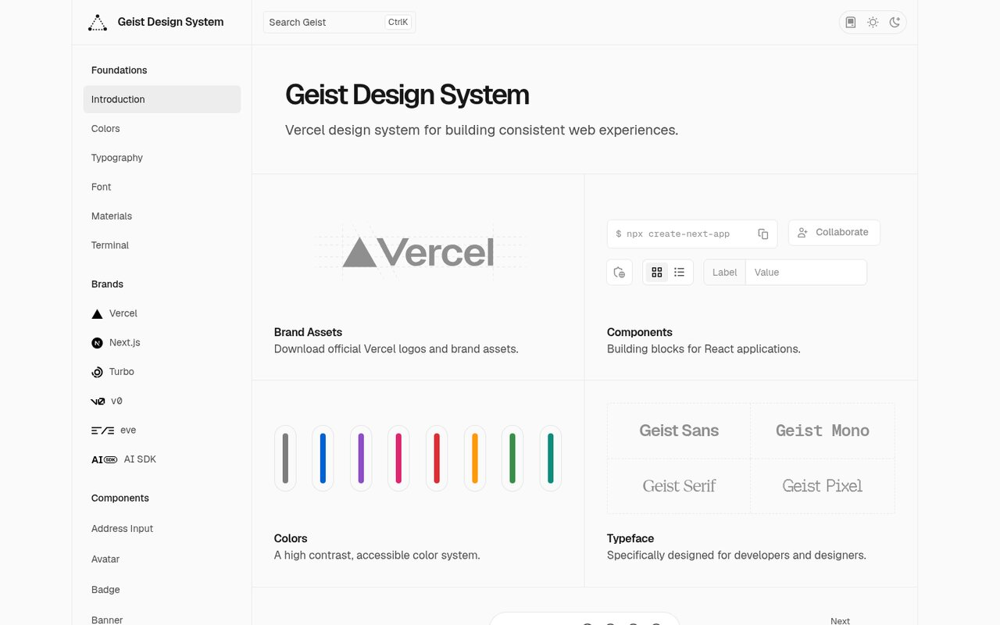

# F10 极简黑白灰设计系统与组件规范

原作：Vercel Geist Design System。作者或机构：Vercel。

状态：候选，尚未经宏哥认可。主线：教学门户与轻量化落地页（`portal-docs`）。类型：线上公开设计系统文档。

[访问真实线上页面](https://vercel.com/geist/introduction)

## 实测界面截屏

## 核心交互与设计机制

- 左侧分组组件树 + 右侧实时组件画廊
- 克制的黑白灰语义色阶与高对比度可访问性色板
- 字体标尺（Sans/Mono/Serif）系统化呈现
- 命令式站内检索（Cmd+K）

## 本轮筛选意见

以下为 AI 的交互与设计观察，等待宏哥判断。

- 可观察之处：把字体、色彩、图标、交互组件和终端风格统一在一套极其克制的规范里，视觉噪音极低，工程落地成本可控。
- 与宏哥工作的关联：直接服务 yuqing-agent-system 的 design-system token 治理，以及《Web 前端开发》课程讲解设计系统与 Tailwind 组件规范。
- 局限与迁移边界：极简黑白灰风格在人文/艺术类竞赛作品中可能显得偏冷，迁移到文化叙事类项目时需叠加主题色与中文衬线体气质。
- 技术栈线索：Next.js、React、CSS Variables、Geist 字体族

## 认可记录

等待宏哥指定整站、具体页面或局部交互机制。

## 来源与版权边界

核看与截屏日期：2026-11-21。截屏视口：1440×900（等比例缩放至 1280×800，未裁剪与改绘）。

第三方公开网页，原作者保留全部权利；本公开仓库仅保留原始链接与少量界面截屏用于教学、科研与设计评述引用，不搬运源码或商用素材包。
