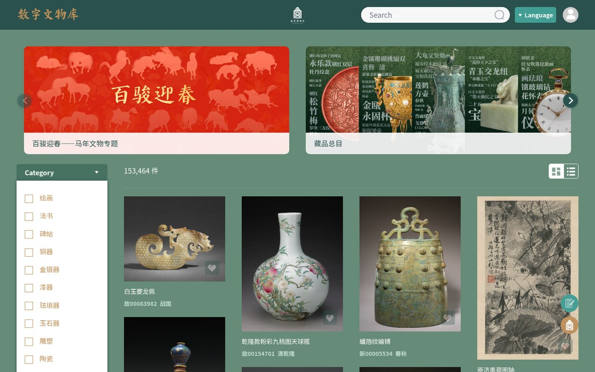

# F13 超大规模文物多维检索与高清检视库

原作：故宫博物院数字文物库。作者或机构：故宫博物院。

状态：候选，尚未经宏哥认可。主线：可交互解释与数字人文（`explorable-humanities`）。类型：线上数字人文检索与展陈平台。

[访问真实线上页面](https://digicol.dpm.org.cn/)

## 实测界面截屏

## 核心交互与设计机制

- 故宫青绿传统色系与现代检索界面的克制融合
- 左侧多维分类筛选树（器类/朝代）+ 右侧瀑布流文物卡
- 15万+ 藏品总量实时反馈与中英文切换
- 顶部专题推荐位（马年文物专题/藏品总目）与全局检索联动

## 本轮筛选意见

以下为 AI 的交互与设计观察，等待宏哥判断。

- 可观察之处：国内数字人文藏品平台的标杆之作：既保留鲜明的东方文物展陈气质，又具备极高的检索效率、清晰编号与零冗余的卡片信息密度。
- 与宏哥工作的关联：极度契合《丝路文化智能叙事与国际传播》及计算机设计大赛/NCDA 文化类项目，示范“传统美学配色 + 现代多维筛选 + 藏品详情卡”的平衡。
- 局限与迁移边界：高分辨率深层缩放检视依赖后端瓦片图服务；教学项目借鉴时可用静态缩略图 + 轻量前端分面筛选复刻其信息架构。
- 技术栈线索：现代前端分面检索界面、瓦片图高清检视、响应式藏品网格

## 认可记录

等待宏哥指定整站、具体页面或局部交互机制。

## 来源与版权边界

核看与截屏日期：2026-11-21。截屏视口：1440×900（等比例缩放至 1280×800，未裁剪与改绘）。

第三方公开网页，原作者保留全部权利；本公开仓库仅保留原始链接与少量界面截屏用于教学、科研与设计评述引用，不搬运源码或商用素材包。
