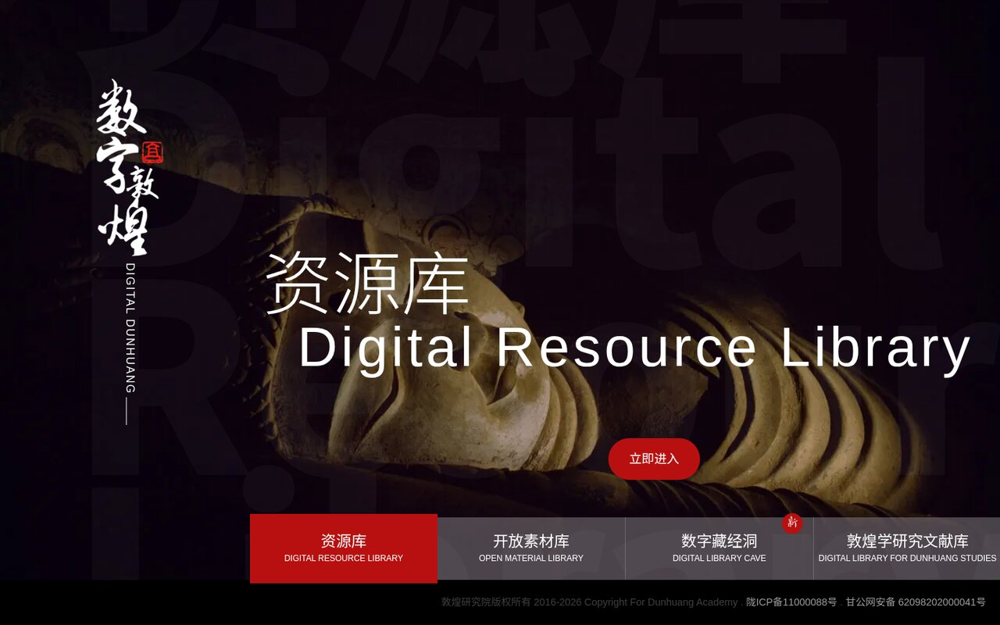

# F14 丝路石窟数字资源与多库入口门户

原作：数字敦煌。作者或机构：敦煌研究院。

状态：候选，尚未经宏哥认可。主线：可交互解释与数字人文（`explorable-humanities`）。类型：线上数字人文与文化遗产门户。

[访问真实线上页面](https://www.e-dunhuang.com/)

## 实测界面截屏

## 核心交互与设计机制

- 深色沉浸式石窟视觉首屏 + 敦煌红功能入口底栏
- 四大子库清晰分流（资源库/开放素材库/数字藏经洞/研究文献库）
- 中英双语标题与书法体品牌标识并置
- 零干扰单屏入口直接导向交互探索

## 本轮筛选意见

以下为 AI 的交互与设计观察，等待宏哥判断。

- 可观察之处：直接立足丝路与敦煌文化语境，用极具仪式感的深色低照度画幅烘托石窟文物，同时底部四个色块入口把学术、素材与互动体验清楚分流。
- 与宏哥工作的关联：与西北民族大学地域文化特色及《丝路文化智能叙事与国际传播》课程高度契合，是文化展陈类落地页首屏构图与色彩克制的直接范本。
- 局限与迁移边界：首屏入口偏沉浸式展示，洞窟全景漫游与高清壁画体验需点击进入二级资源库，对网络带宽与 WebGL 性能有一定要求。
- 技术栈线索：全屏视口门户、全景/WebGL 洞窟漫游子系统

## 认可记录

等待宏哥指定整站、具体页面或局部交互机制。

## 来源与版权边界

核看与截屏日期：2026-11-21。截屏视口：1440×900（等比例缩放至 1280×800，未裁剪与改绘）。

第三方公开网页，原作者保留全部权利；本公开仓库仅保留原始链接与少量界面截屏用于教学、科研与设计评述引用，不搬运源码或商用素材包。
