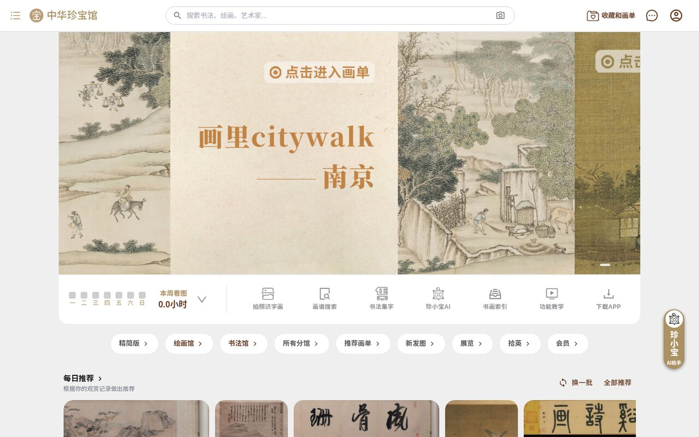

# F15 中国传统书画专题策展与高清交互平台

原作：中华珍宝馆。作者或机构：中华珍宝馆。

状态：候选，尚未经宏哥认可。主线：可交互解释与数字人文（`explorable-humanities`）。类型：线上数字书画策展与检索平台。

[访问真实线上页面](https://www.ltfc.net/)

## 实测界面截屏

## 核心交互与设计机制

- 浅宣纸色温底色 + 策展式主题横幅（如“画里 citywalk”）
- 顶部极简检索 + 下方多维学科/媒介图标导航
- 按朝代/画派/专题组合的轻量标签栏
- 将古画长卷转化为主题“画单”的现代交互心智

## 本轮筛选意见

以下为 AI 的交互与设计观察，等待宏哥判断。

- 可观察之处：把传统书画的高门槛学术档案，转译成了大众和学生都能轻松上手的“画单 + 主题策展 + 轻量标签筛选”界面，宣纸质感柔和耐看。
- 与宏哥工作的关联：非常适合指导学生做中国传统文化、地方非遗或文学地理类互动作品，学习如何把静态古籍/图像组织成有主题线索的策展入口。
- 局限与迁移边界：部分超高清大图原图下载与高级功能需登录或会员权限，公开浏览与交互结构拆解不受影响。
- 技术栈线索：现代前端 SPA、瓦片图长卷浏览、主题策展标签体系

## 认可记录

等待宏哥指定整站、具体页面或局部交互机制。

## 来源与版权边界

核看与截屏日期：2026-11-21。截屏视口：1440×900（等比例缩放至 1280×800，未裁剪与改绘）。

第三方公开网页，原作者保留全部权利；本公开仓库仅保留原始链接与少量界面截屏用于教学、科研与设计评述引用，不搬运源码或商用素材包。
