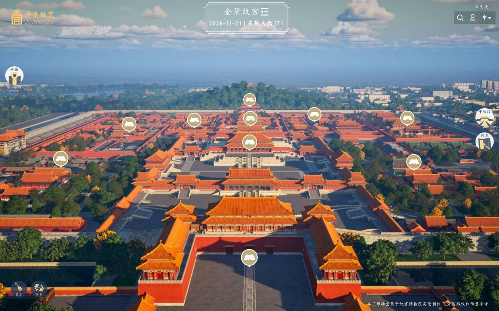

# F16 空间热点与全景漫游数字展陈标杆

原作：全景故宫。作者或机构：故宫博物院。

状态：候选，尚未经宏哥认可。主线：可交互解释与数字人文（`explorable-humanities`）。类型：线上空间全景交互展陈。

[访问真实线上页面](https://pano.dpm.org.cn/)

## 实测界面截屏

## 核心交互与设计机制

- 全屏鸟瞰全景画布 + 空间定位热点图钉
- 极简悬浮 HUD 控件（顶部标题与实时人数、左导览、右地图/中轴线切换）
- 不遮挡主画面的边缘工具条布局
- 宏观空间总览到微观殿宇漫游的层级过渡

## 本轮筛选意见

以下为 AI 的交互与设计观察，等待宏哥判断。

- 可观察之处：示范了全屏空间交互页面如何克制地放置 UI 控件：整个 100% 视口让给建筑空间本身，导航、地图、检索与导览全部收束在四角半透明浮层中。
- 与宏哥工作的关联：直接服务《互动媒体设计》与竞赛指导中的空间叙事、虚拟展馆、地理地图交互项目，避免学生在做全屏地图/全景页时把控件堆满画面。
- 局限与迁移边界：全景图与 3D 鸟瞰资源体积较大，移动端弱网环境需要降级为静态平面导览图；教学原型可用 2D 地图 + 热点浮层实现同等交互逻辑。
- 技术栈线索：WebGL / 全景漫游引擎（Krpano 类架构）+ 半透明悬浮 HUD

## 认可记录

等待宏哥指定整站、具体页面或局部交互机制。

## 来源与版权边界

核看与截屏日期：2026-11-21。截屏视口：1440×900（等比例缩放至 1280×800，未裁剪与改绘）。

第三方公开网页，原作者保留全部权利；本公开仓库仅保留原始链接与少量界面截屏用于教学、科研与设计评述引用，不搬运源码或商用素材包。
